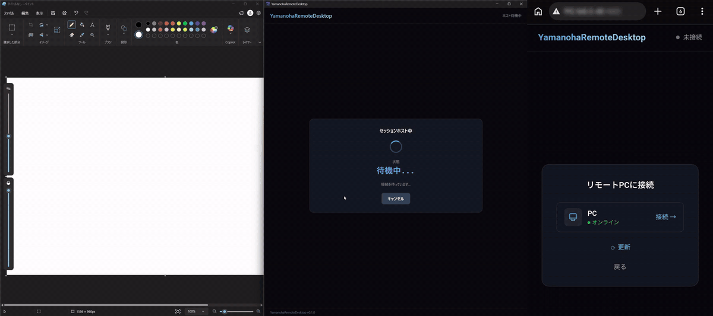

# YamanohaRemoteDesktop

Windows PC の画面を、WebRTC でスマートフォンやブラウザへ低遅延で配信し、手元から操作できるリモートデスクトップです。
画面キャプチャ、GPU エンコード、ネットワーク配信、入力の逆送信までを、自分で組み上げています。

- 期間: 2026/06/22 〜 07/08 に作りました(24 コミット)。その後、11/02 〜 11/11 に、セキュリティの強化・性能の測定・デモ GIF を足しました(6 コミット。合計 30)
- 対象 OS: Windows(Desktop Duplication API / Direct3D 11 / NVENC / Media Foundation を使用)
- 動作確認した操作端末: Windows、Google Pixel 9(タッチ操作、無線キーボード)



左が PC、右がスマホ(Pixel 9)のブラウザです。スマホからホストを選ぶと、PC に許可のダイアログが出て、許可すると配信が始まります。スマホの指でペイントに描いた線が PC に反映され、その画面がスマホに返ってきます。切断すると、PC は待機中に戻ります。

- 撮影条件: PC とスマホは同じ Wi-Fi、シグナリングサーバーも同じ PC で動かしています(2026/11/11)。別のネットワーク間の接続(fly.io のサーバーと TURN を使う構成)は、この動画では見せていません。
- 2 本の録画を、絵を描いた瞬間の画面の変化で時刻合わせして、左右に並べています。接続元の IP とアドレスはぼかしています。

## 何を作ったか

```
 ┌─────────────── ホスト PC (Windows) ────────────────┐         ┌──────── クライアント ────────┐
 │ Tauri アプリ (Rust + TypeScript)                    │         │ ブラウザ / スマホ (TS)        │
 │   │ FFI (C API)                                     │         │                              │
 │   ▼                                                 │  WebRTC │  映像を表示                  │
 │ yamanoha_core.dll (C++20)                           │ ──────▶ │  マウス/キー/タッチを送信     │
 │   Capture → Encode → Send   (3 スレッド)            │ ◀────── │                              │
 │   └ libdatachannel (DTLS-SRTP / mbedTLS)            │ DataCh. └──────────────▲───────────────┘
 └──────────────▲──────────────────────────────────────┘                        │
                │ WebSocket (SDP / ICE / 操作メッセージ)                         │
                └──────────────  シグナリングサーバー (Node.js)  ────────────────┘
                                 JWT 認証 / bcrypt / SQLite / TURN 対応
```

| 層 | 技術 | 場所 |
|---|---|---|
| 配信エンジン | C++20、Direct3D 11、DXGI Desktop Duplication、NVENC、Media Foundation、libdatachannel | `native/` |
| ホストアプリ | Rust、Tauri 2(C++ DLL を FFI で呼び出し、`SendInput` で入力を再現) | `src-tauri/` |
| クライアント | TypeScript、Vite、Tailwind(マウス・キー・タッチ・ディスプレイ切り替え) | `src/` |
| シグナリング | Node.js、ws、JWT、bcrypt、better-sqlite3(Render / Fly.io 用の設定つき) | `signaling-server/` |

## 設計のポイント

### 1. 3 スレッドのパイプライン(`native/src/pipeline/frame_pipeline.cpp`)

```
CaptureLoop ──▶ EncoderLoop ──▶ SenderLoop
 (画面取得)       (H.264 化)      (WebRTC へ送信)
```

- キャプチャ、エンコード、送信を別スレッドに分け、`BlockingQueue` と mutex / condition_variable / atomic でつないでいます。
- **遅延を溜めない**: 処理中のフレームが 3 枚(`kMaximumFramesInFlight`)に達したら、新しいフレームのキャプチャを**スキップ**します。詰まったときに古い映像を送り続けて遅れが増えるのを避けるためです。
- **静止画面への対策**: 画面に変化がないときはエンコードを省略しますが、**3 秒ごとにキーフレームを強制**します(コミット「video freeze on static desktop」)。途中参加や欠落からの復帰を保証し、クライアント側でもフリーズを検知します。
- **送信失敗からの復帰**: 送信に失敗したら、次のフレームをキーフレームにして、受信側のデコーダを再同期させます。
- エンコード用のテクスチャは **4 枚のプールを事前確保**して使い回します。フレームごとの確保コストを避けるためです。

### 2. 複数 GPU 環境への対応(ハイブリッド GPU)

ノート PC のように、画面を出している GPU(Intel など)と、NVENC を持つ GPU(NVIDIA)が別のことがあります。

- エンコード用のデバイスは **NVIDIA を優先して自動選択**し、見つからなければキャプチャと同じアダプタを使います。
- GPU をまたぐときは、キャプチャ GPU → CPU 上のステージングテクスチャ → エンコード GPU の順でコピーします(`CopyToEncodeTexture`)。この途中でカーソルも合成し、画面の回転(縦向きディスプレイ)にも対応しています。

### 3. エンコーダの抽象化とフォールバック

- `VideoEncoder` という抽象クラスの下に、`NvencEncoder`(NVENC SDK を直接使用)と `MfEncoder`(Media Foundation)を置いています。
- **NVENC を優先し、失敗したら Media Foundation に自動で切り替えます。** これで NVIDIA 以外の GPU(Intel QuickSync / AMD など)でも動きます(コミット「Nvidia GPU以外でもOK」)。
- 設定は低遅延重視です(P1 プリセット、B フレームなし、CBR、GOP 30)。

### 4. 動的ビットレート(`adaptive_bitrate_controller.cpp`)

- 受信側が推定した帯域の **85%** を目標ビットレートにします(余裕を残すためです)。
- 変更は **1 秒に 1 回まで**、かつ**現在値から 10% 以上(最低 100kbps)**変わるときだけです。細かい揺れで再設定を繰り返さないようにしています。
- 変更したあとは、画質の急変をやわらげるためにキーフレームを要求します。
- この部分は `native/test/pipeline_primitives_test.cpp` で、帯域が減る場合と回復する場合の動きをテストしています。

### 5. 複数ディスプレイと切り替え

- ディスプレイを列挙して、クライアントから選べます。
- 切り替えたときは、**WebRTC の接続を保ったまま**、パイプラインだけを作り直します(`DisplaySessionManager::SwitchDisplay`)。

### 6. C++ と Rust の境界

- C++ 側は `extern "C"` の小さな C API(`core.h`)だけを公開し、Rust(Tauri)から FFI で呼び出します。コールバック(SDP、ICE、メッセージ、接続状態)は関数ポインタで渡します。
- DLL(`yamanoha_core.dll`、`datachannel.dll`)は、Rust の `build.rs` が出力先に自動コピーします。

### 7. WebRTC まわりの調整

- libdatachannel(v0.24.5)を、暗号ライブラリ mbedTLS(v3.6.6)で構成し、CMake の `FetchContent` で取得しています。
- **mbedTLS の TLS 1.3 を無効化**しています。mbedTLS は DTLS 1.3 を実装していないため、有効だと DTLS のハンドシェイクが `MBEDTLS_ERR_SSL_FEATURE_UNAVAILABLE` で失敗するためです(`CMakeLists.txt` に理由を記載)。
- 公開環境向けに TURN サーバー対応も入れています。

### 8. 認証とシグナリング

- シグナリングサーバーは、ユーザー登録とログイン(bcrypt でハッシュ化、JWT を発行)を持ち、WebSocket の接続時にトークンを検証します。
- ホストとクライアントの役割を分け、役割に合わないメッセージは処理しません(例:`input` はクライアントからのみ受け付ける)。
- 接続の生死を、ping / pong のハートビートで確認しています。

## ビルドと実行

前提: Windows、Visual Studio(MSVC)、CMake 3.20 以上、Rust、Node.js。NVENC を使うには NVIDIA GPU が必要です(なければ Media Foundation に切り替わります)。

```powershell
# 1. C++ のコアライブラリ(依存の libdatachannel / mbedTLS は自動取得)
cmake -S native -B native/build
# 依存の mbedTLS を先に作る(個別のターゲットを指定するとき、リンクの順番のため)
cmake --build native/build --config Release --target mbedcrypto mbedx509 mbedtls
cmake --build native/build --config Release --target yamanoha_core
# 注: `cmake --build` をターゲット指定なしで実行すると、`capture_test.cpp` がコンパイルできず失敗する(既知の問題。下記)

# 2. ホストアプリ(Tauri)
npm install
npm run tauri dev

# 3. シグナリングサーバー(ローカル)
cd signaling-server
npm install
npm start          # 既定のポートは 8080(環境変数 PORT で変更)
```

**サーバーには、環境変数 `JWT_SECRET`(32 文字以上のランダムな値)が必須です。** 未設定のときは、サーバーが起動しません(以前は、ソースコードに書かれた既定値を使っていて、その値を知る人は、パスワードなしでトークンを作れました)。詳しい設定と、デプロイの手順は、[signaling-server/README.md](signaling-server/README.md) を参照してください。

### セキュリティ

このアプリは、**ほかの端末から、この PC の画面を見て、操作できる**ものです。そのため、次の対策を入れています。

- **接続の許可**: クライアントが接続すると、ホスト側に、**アカウント名と接続元の IP を表示した許可のダイアログ**が出ます。「許可する」を押すまで、画面の配信も、マウス・キーボードの操作の受け付けも、始まりません。
- **同じアカウントのホストにだけ接続できる**: ほかのアカウントからは、ホストが見えません。
- **ログインの失敗回数の制限**: 同じユーザー名で 8 回、同じ IP から 20 回失敗すると、15 分間ロックします。
- **新規登録は、既定で閉じる**: 最初の 1 人だけ登録できて、2 人目以降は、サーバーの管理者が `ALLOW_REGISTRATION=1` を設定したときだけです。パスワードは 10 文字以上です。
- ホストのアプリを起動している間だけ、ホストが登録されます。**使わないときは、終了してください。**

### テスト

`native/test/` に、次のプログラムがあります。

| ファイル | 内容 |
|---|---|
| `capture_test.cpp` | 画面キャプチャ(**今のコードではコンパイルできない**) |
| `encode_test.cpp` | キャプチャからエンコードまで |
| `webrtc_test.cpp` | WebRTC 配信の統合テスト |
| `pipeline_primitives_test.cpp` | 動的ビットレート制御と `BlockingQueue`(GPU 不要。`assert` を使うので **Release ビルドでは何も検証しない**) |
| `pipeline_bench.cpp` | **本物の `FramePipeline` を動かして、段階ごとの所要時間・FPS・データチャネルの往復時間を測る**(2026/11/02 追加。結果は [docs/performance.md](docs/performance.md)) |
| `dd_probe.cpp` | Desktop Duplication が、その PC で使えるかを調べる診断用プログラム |

## 開発の流れ(コミット履歴より)

| 日付 | 内容 |
|---|---|
| 06/22 | 土台づくり、スマホ(Pixel 9)での操作 |
| 06/24 | アカウント認証 |
| 06/25 | 同一 Wi-Fi の制限を解除、無線キーボード対応 |
| 07/01 | プロトタイプ完成(安定性に懸念あり)、カーソル表示、リファクタリング |
| 07/02 | マルチディスプレイ、切り替えの高速化、安定化、静止画面のフリーズ修正、Media Foundation へのフォールバック、TURN、動的ビットレート |
| 07/08 | コメント追加、リファクタリング |
| 11/02 | セキュリティの強化(JWT の鍵を必須に、接続の許可、ログインの失敗回数の制限、登録を既定で閉じる)、テスト |
| 11/06 | 性能の測定(段階ごとの所要時間、FPS)、Desktop Duplication の診断 |
| 11/11 | ホストの画面に今の状態を表示、デモ GIF |
| 11/13 | 接続開始の遅れ(真っ暗)を修正、操作の往復遅延の測定、ハイブリッド GPU についての記述の訂正 |

## 現状の制限と今後

- **性能を測った。詳細と限界は [docs/performance.md](docs/performance.md)。**
  - **本物の画面での測定(2026/11/06、デスクトップ PC、RTX 5070 Ti、2560x1600、60 fps 目標、NVENC、15 秒 × 3 回)**。p50 は 3 回の範囲:

    | 段階 | 既定のタイマー | タイマー 1 ms |
    |---|---:|---:|
    | キャプチャ取得(Desktop Duplication) | 0.05 ms | 0.04 ms |
    | GPU 間コピー(CPU 経由) | 1.7 ms(p95 5.3〜5.8) | 1.5 ms(p95 3.3) |
    | エンコード完了の待ち(NVENC) | 4.8〜5.2 ms(p95 12.5〜13.0) | 4.5〜4.6 ms(p95 10.7〜11.3) |
    | 送信呼び出し | 0.14 ms | 0.13 ms |
    | **ホスト内の合計(取得開始 → 送信呼び出し完了)** | **6.9〜7.2 ms** | **6.4 ms** |
    | **FPS** | **29.7〜29.9** | **41.2〜41.8** |
    | データチャネルの往復(同一 PC 内) | 0.22 ms | 0.14 ms |

  - **FPS が目標の 60 に届かない原因の 1 つは、Windows のタイマーの粒度だった。** 1 フレームの処理は約 7 ms なのに約 30 FPS しか出ない。キャプチャのループは、残りの時間を `sleep_for` で待つ。既定の粒度(約 15.6 ms)では、その待ちが切り上がる。粒度を 1 ms にすると、6 回とも 30 → 41 FPS に上がった。それでも 60 に届かない理由は、まだ分かっていない。
  - ハイブリッド GPU のノート PC(Intel Iris Xe + RTX 3060 Laptop)でも、**本体アプリは本物の画面を取得できる**(2026/11/13 に確認。Intel 側で Desktop Duplication、NVIDIA 側で NVENC)。11/02 に「ノート PC では `DXGI_ERROR_UNSUPPORTED` で使えない」と書いたのは誤りで、失敗していたのは診断用の `dd_probe` やベンチマークの `pipeline_bench` だった。ハイブリッド GPU では、プロセスがどちらの GPU で動くかによって、画面がどちらの GPU の持ち物に見えるかが変わる。テスト用のプログラムは NVIDIA 側に見えて失敗し、本体は Intel 側に見えて成功した(本体が Intel 側で動く理由は、まだ確かめていない)。取得に失敗したとき、FramePipeline が黙ってダミー画像に切り替わる点は、直していない。
- **操作の往復遅延(2026/11/13、ノート PC → Pixel 9、同じ Wi-Fi、22 回)**: スマホでタップしてから、その結果がスマホの画面に映るまで **p50 211 ms、p90 249 ms、最小 164 ms、最大 262 ms**。タップ → クリックの送信 → PC の画面の変化 → キャプチャ・エンコード → 送信 → 受信側のバッファ・デコード・表示、をすべて含む。スマホの画面録画(約 30 fps)で数えたので、1 回ごとに ±33 ms ほどの誤差がある。測り方は `tools/latency/README.md`。ホスト内の処理は約 7 ms なので、残りの大半はホストの外(ネットワーク、受信側のジッターバッファ(目標 120 ms)、デコード、表示)にあると考えられるが、内訳はまだ分けて測っていない。
- **直した(2026/11/13)**: WebRTC の接続開始が、ICE 候補の収集の完了待ちで、0.1 〜 約 24 秒かかることがあった(`WebrtcStreamer` は、収集が終わるまで Offer を出さなかった)。応答しない STUN の問い合わせがある回線(学校の Wi-Fi など)では、その間にクライアントが待ちきれず、**画面が真っ暗のまま**になっていた。Offer をすぐ送り、候補は見つかるたびに後から送る(Trickle ICE)ように直し、同じ回線で、許可してから経路がつながるまでが **約 0.3 秒**になった。
- 自動テストは、GPU を使わない部分(ビットレート制御とキュー)に限られます。キャプチャとエンコードのテストは、実機の GPU が必要な手動のものです。
- `signaling-server/README.md` のプロトコル表は、WebSocket でフレームを送っていた初期の設計のままで、現在の WebRTC 方式(`webrtc-offer` / `webrtc-answer` / `webrtc-ice` など)に追いついていません。
- Windows 専用です。
